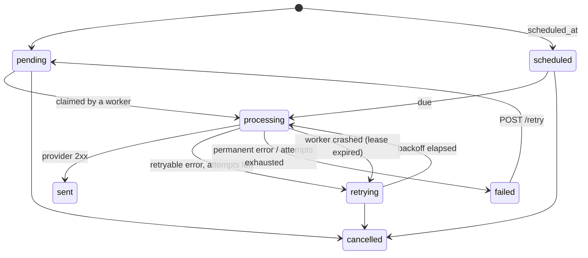

# Event-Driven Notification System

A Go service that accepts notification requests (SMS, email, push), queues them
durably and delivers them asynchronously through an external provider, with
per-channel rate limiting, priorities, retries with backoff, a circuit breaker,
idempotency, scheduling, templates, real-time WebSocket status updates,
metrics, structured logs and distributed tracing.

| Requirement | Where |
|---|---|
| Create / batch (≤ 1000) / get / cancel / list with filters + pagination | [`internal/httpapi`](internal/httpapi) |
| Async processing via queue workers | [`internal/worker`](internal/worker), [`internal/store/queue.go`](internal/store/queue.go) |
| 100 msg/s **per channel** (global across all workers) | [`internal/ratelimit`](internal/ratelimit) |
| Priority queue (high / normal / low) | dispatch index + `ORDER BY priority` |
| Content validation | [`internal/domain/validation.go`](internal/domain/validation.go) |
| Idempotency | unique key index + payload check + provider `Idempotency-Key` |
| Delivery & retry logic | [Retry design](#delivery--retry-logic) |
| Metrics, structured logs with correlation IDs, health checks | `/v1/metrics`, `/metrics`, `/healthz`, `/readyz` |
| **Bonus:** failure handling, scheduling, templates, WebSocket, tracing, CI | all implemented |
| Docker Compose, OpenAPI, versioned migrations, single-command tests | `docker compose up`, `/docs`, [`migrations/`](migrations), `make test` |

---

## Quick start

Requirements: Docker with Compose v2.

```bash
docker compose up --build
```

| What | URL |
|---|---|
| API + Swagger UI | http://localhost:8080/docs |
| OpenAPI spec | http://localhost:8080/openapi.yaml |
| Real-time metrics (JSON) | http://localhost:8080/v1/metrics |
| Jaeger (traces) | http://localhost:16686 |
| Prometheus | http://localhost:9090 |
| Mock provider counters | http://localhost:8090/stats |

Then, in another terminal, `make smoke` (needs `curl` and `jq`) creates a template,
a notification and a 300-item batch and waits until everything is delivered.

The stack starts PostgreSQL, Redis, a one-shot `migrate` job, the `api`, the `worker`,
a mock provider, Jaeger and Prometheus. Scale the workers with
`docker compose up --scale worker=3` — the queue and the rate limiter are shared.

### Using webhook.site as the provider

By default the worker posts to the bundled **mock provider**, which behaves like the
webhook.site endpoint of the assignment (`202 {"messageId","status","timestamp"}`) and
fails 10 % of requests on purpose so retries are visible (`MOCK_FAILURE_RATE`).
To use webhook.site:

1. Open https://webhook.site, click **Edit** and set status code `202`, content type
   `application/json` and a body such as
   `{"messageId":"wh-1","status":"accepted","timestamp":"2026-01-01T00:00:00Z"}`.
2. `cp .env.example .env` and set `PROVIDER_URL=https://webhook.site/<your-uuid>`.
3. `docker compose up --build -d worker` — requests now appear on webhook.site, with
   `X-Correlation-ID`, `Idempotency-Key` and `traceparent` headers.

Note that free webhook.site URLs are rate limited; the worker treats their `429`
answers as retryable and honours `Retry-After`.

---

## Architecture

```mermaid
flowchart LR
    client([API client]) -- REST --> api[API]
    client <-- WebSocket --- api
    api -- "INSERT (one transaction)" --> pg[(PostgreSQL<br/>notifications = durable queue)]
    api -- PUBLISH status --> redis[(Redis)]
    worker[Worker × N] -- "claim: FOR UPDATE SKIP LOCKED" --> pg
    worker -- "GCRA token per channel" --> redis
    worker -- "POST {to, channel, content}" --> provider([Provider<br/>webhook.site / mock])
    worker -- record outcome + attempt --> pg
    worker -- PUBLISH status --> redis
    redis -- SUBSCRIBE --> api
```

One binary, `notifier`, runs as `api`, `worker` or `migrate`.

* **API** validates requests and writes notifications in a single transaction. A row
  *is* the queue entry, so there is no dual write between a database and a broker:
  an accepted notification can never be lost or enqueued twice.
* **Worker** runs one dispatcher per channel. Each dispatcher claims due rows
  (highest priority first), takes one rate-limit token per message and hands it to a
  pool of sender goroutines that call the provider and record the outcome.
* **Redis** provides the cluster-wide rate limiter and a Pub/Sub channel that carries
  status changes to every API instance for WebSocket fan-out.

### Notification lifecycle



---

## Design decisions

### PostgreSQL as the queue
Workers claim work with

```sql
WITH due AS (
  SELECT id FROM notifications
  WHERE channel = $1 AND status IN ('pending','scheduled','retrying') AND next_attempt_at <= now()
  ORDER BY priority, next_attempt_at
  LIMIT $2
  FOR UPDATE SKIP LOCKED)
UPDATE notifications SET status = 'processing', attempts = attempts + 1, locked_until = now() + lease ...
```

served by a partial index `(channel, priority, next_attempt_at) WHERE status IN (queued)`.
`SKIP LOCKED` lets any number of workers poll the same queue without blocking each
other or receiving the same row. Priorities, scheduling and retry backoff are the
same mechanism — `next_attempt_at` — so there is no separate delay queue.

**Why not Kafka / RabbitMQ?** The rate limit caps egress at 3 × 100 = 300 msg/s,
which is ~26 M/day: comfortably inside what one PostgreSQL instance claims with
`SKIP LOCKED` (thousands of rows/s). A broker would add a dual-write problem
(needing an outbox), a second source of truth for status, and per-message priority
and delayed delivery that brokers do poorly. If the provider limits grew by orders of
magnitude or other services needed the event stream, the next step would be a
transactional outbox relayed to Kafka, partitioned by channel.

### Rate limiting: 100 msg/s per channel, globally
`ratelimit.Redis` implements GCRA in Redis (`go-redis/redis_rate`) with **burst 1**:
messages are spaced evenly (10 ms apart), which guarantees no one-second window ever
holds more than 100 sends, even with many worker replicas. Only the dispatcher
goroutine of each channel takes tokens, so Redis sees one caller per channel per
process; the sender pool supplies I/O concurrency (with ~100 ms provider latency,
100 msg/s needs ≥ 10 in-flight calls; the default is 20). If Redis is down the worker
**fails closed** (pauses the channel) instead of risking a provider ban.

Measured on the Compose stack with the mock provider failing 10 % of calls: 1000 SMS with
one worker → at most 97 provider calls in any sliding 1 s window; 1500 SMS with
`--scale worker=3` → work split 544 / 494 / 462 across replicas, peak 101 per sliding
second. (Those numbers use the time each result was *recorded*, which trails the paced
send time by the 20–150 ms provider latency, so ±1 is measurement jitter.)

### Priority
Strict priority inside a channel (`high` → `normal` → `low`), FIFO by due time inside
a priority. Channels are independent, so an email burst never delays SMS. Under
sustained overload `low` can starve; acceptable for flash-sale style bursts, and
priority aging is a small change to the `ORDER BY` if needed.

### Idempotency
* **Creation** — an optional `idempotency_key` (body field or `Idempotency-Key`
  header) has a unique partial index. A repeat returns the original notification
  (`200`, `Idempotent-Replayed: true`); the same key with a *different* payload is a
  `409`. Keys are de-duplicated inside a batch too.
* **Sending** — a row is processed by exactly one worker at a time (claim + lease),
  and every state change is a conditional `UPDATE ... WHERE status = 'processing'`, so a
  cancelled or already-finished notification is never sent again. The notification ID
  is sent as the provider's `Idempotency-Key`. Delivery is **at-least-once**: if a
  worker dies after the provider accepted a message but before recording it, the
  lease expires and the message is retried — the provider-side key is what makes that
  retry harmless. Exactly-once over HTTP is not possible without it.

### Delivery & retry logic

| Provider result | Classification | Action |
|---|---|---|
| `2xx` | success | `sent`, store `messageId` |
| network error, timeout, `408`, `425`, `429`, `5xx` | retryable | `retrying` with backoff (honours `Retry-After`) |
| other `4xx` | permanent | `failed` immediately (retrying cannot fix the request) |
| retryable but `attempts == MAX_ATTEMPTS` | exhausted | `failed` |

* **Backoff:** exponential with *equal jitter* — the n-th retry waits a random time in
  `[d/2, d]`, `d = RETRY_BASE_DELAY · 2ⁿ⁻¹`, capped at `RETRY_MAX_DELAY`. Jitter
  spreads the retries of a burst that failed together. Defaults (2 s base, 5 attempts)
  give ≈ 1–2 s, 2–4 s, 4–8 s, 8–16 s; production would use e.g. 30 s base and 8 attempts.
* **Circuit breaker per channel:** after `BREAKER_FAILURE_THRESHOLD` consecutive
  retryable failures the channel stops claiming work for `BREAKER_COOLDOWN`, then lets a
  single probe through. During an outage queued messages keep their attempt budget
  instead of burning it against a dead provider. 4xx answers count as healthy.
* **Crash safety:** a claim is a lease (`WORKER_LEASE`; start-up refuses a lease shorter
  than a provider call plus the time to pace one claimed batch). A reaper re-queues rows whose lease expired. The
  attempt counter is incremented at claim time, so a message that crashes its worker
  still exhausts its budget (no poison-pill loop).
* **Graceful shutdown:** on `SIGTERM` dispatchers stop claiming, in-flight provider calls
  finish and are recorded, claimed-but-unsent rows are released without using an attempt.
* **Dead letters:** `failed` notifications stay queryable (`?status=failed`) with
  `last_error` and the full attempt history (`/attempts`); `POST /v1/notifications/{id}/retry`
  re-queues one with a fresh budget.

### Validation

| Channel | Recipient | Content (characters) |
|---|---|---|
| `sms` | E.164 (`+905551234567`) | 1–1600 (10 concatenated segments) |
| `email` | plain address (`jane@example.com`) | 1–20 000 |
| `push` | device token, 16–512 chars `[A-Za-z0-9_-:.]` | 1–1000 |

Plus: valid UTF-8, `scheduled_at` in the future and ≤ 30 days ahead, idempotency key
≤ 255 printable characters, unknown JSON fields rejected (typos fail loudly), 1 MiB /
16 MiB body limits. Batches are **all-or-nothing**: one invalid item rejects the batch
with per-item paths such as `notifications[3].recipient`.

### Templates and scheduling
Templates hold `{{variable}}` placeholders; the notification references `template_id` +
`variables` and is rendered **at creation**, so the stored content is exactly what is
sent and is validated like any other content. Values are inserted literally (no template
injection). Scheduled notifications are rows with a future `next_attempt_at`.

---

## API examples

```bash
# Single notification (202 Accepted)
curl -s localhost:8080/v1/notifications -H 'Content-Type: application/json' \
  -H 'X-Correlation-ID: checkout-123' -H 'Idempotency-Key: order-123-sms' \
  -d '{"recipient":"+905551234567","channel":"sms","content":"Your order has shipped","priority":"high"}'

# Batch (up to 1000)
curl -s localhost:8080/v1/notifications/batch -H 'Content-Type: application/json' -d '{
  "notifications": [
    {"recipient":"+905551234567","channel":"sms","content":"Flash sale starts now!","priority":"high"},
    {"recipient":"jane@example.com","channel":"email","content":"Our flash sale is live"},
    {"recipient":"fcm:APA91bHun4MxP5egoKMwt2KZFBaFUH","channel":"push","content":"50% off","priority":"low"}
  ]}'

# Status by ID / by batch
curl -s localhost:8080/v1/notifications/<id>
curl -s localhost:8080/v1/notifications/<id>/attempts
curl -s localhost:8080/v1/batches/<batch_id>

# List with filters and cursor pagination
curl -s 'localhost:8080/v1/notifications?status=sent&channel=sms&created_from=2026-01-01T00:00:00Z&limit=50'
curl -s 'localhost:8080/v1/notifications?status=sent&channel=sms&limit=50&cursor=<next_cursor>'

# Cancel (409 once a worker picked it up)
curl -s -X POST localhost:8080/v1/notifications/<id>/cancel
curl -s -X POST localhost:8080/v1/batches/<batch_id>/cancel

# Schedule
curl -s localhost:8080/v1/notifications -H 'Content-Type: application/json' \
  -d '{"recipient":"jane@example.com","channel":"email","content":"Reminder","scheduled_at":"2026-12-24T09:00:00Z"}'

# Template + variables
curl -s localhost:8080/v1/templates -H 'Content-Type: application/json' \
  -d '{"name":"order.shipped","channel":"sms","content":"Hi {{name}}, order {{order_id}} is on its way."}'
curl -s localhost:8080/v1/notifications -H 'Content-Type: application/json' \
  -d '{"recipient":"+905551234567","channel":"sms","template_id":"<template_id>","variables":{"name":"Ayşe","order_id":"A-1001"}}'

# Re-queue a failed notification
curl -s -X POST localhost:8080/v1/notifications/<id>/retry

# Real-time updates (any WebSocket client, e.g. websocat)
websocat 'ws://localhost:8080/v1/ws?batch_id=<batch_id>'
```

Errors share one shape:

```json
{
  "error": {
    "code": "validation_failed",
    "message": "the request contains invalid fields",
    "details": [{"field": "notifications[3].recipient", "message": "must be an E.164 phone number such as +905551234567"}]
  },
  "correlation_id": "3f6c2b1e-9f7a-4d8e-8c55-0b2f1d3e4a5b"
}
```

The full contract is in [`api/openapi.yaml`](api/openapi.yaml) (Swagger UI at `/docs`).
A contract test runs real handler responses through the spec, so the two cannot drift.

---

## Observability

* **`GET /v1/metrics?window=5m`** — real-time JSON computed from the database, so it
  covers every API and worker instance: queue depth per channel / status / priority,
  sent / failed counts, success and failure rates, throughput, end-to-end latency
  p50/p95/p99, provider attempts, error rate and latency.
* **`GET /metrics`** (API) and **`:9091/metrics`** (worker) — Prometheus:
  `notifications_created_total`, `notification_deliveries_total{channel,result}`,
  `notification_provider_request_duration_seconds`, `notification_end_to_end_latency_seconds`,
  `notification_queue_depth`, `notification_rate_limit_wait_seconds`,
  `notification_circuit_breaker_state`, `notification_deliveries_in_flight`,
  `http_requests_total`, `http_request_duration_seconds`, `websocket_clients`.
* **Structured logs** — JSON (`log/slog`). Every line logged with a context carries
  `correlation_id`, `trace_id` and `span_id`. The correlation ID comes from
  `X-Correlation-ID` / `X-Request-ID` (or is generated), is returned in the response,
  stored with each notification, logged by the worker and forwarded to the provider.
* **Distributed tracing** — OpenTelemetry → Jaeger. The API stores the W3C
  `traceparent` with the notification and the worker continues that trace when it
  delivers — even minutes later, from another process — so one trace shows
  *HTTP request → delivery attempt(s) → provider call*.
* **Health** — `/healthz` (liveness), `/readyz` (PostgreSQL + Redis), worker `:9091/healthz`
  (includes circuit breaker states). Containers use them as Docker health checks.

---

## Configuration

All settings are environment variables (defaults in brackets).

| Variable | Description |
|---|---|
| `DATABASE_URL` | PostgreSQL URL |
| `REDIS_URL` | Redis URL |
| `HTTP_ADDR` [`:8080`] / `METRICS_ADDR` [`:9091`] | API / worker metrics listen address |
| `PROVIDER_URL` | Provider endpoint (webhook.site URL or the mock) |
| `PROVIDER_TIMEOUT` [`10s`] | Timeout of one provider call |
| `RATE_LIMIT_PER_SECOND` [`100`] | Per channel, shared by all workers |
| `RATE_LIMITER` [`redis`] | `redis` (distributed) or `local` (single process) |
| `WORKER_CONCURRENCY` [`20`] | In-flight provider calls per channel per worker |
| `WORKER_BATCH_SIZE` [`50`] | Rows claimed per poll |
| `WORKER_POLL_INTERVAL` [`250ms`] | Idle poll interval |
| `WORKER_LEASE` [`60s`] | Claim lease (> `PROVIDER_TIMEOUT` + 5s + batch pacing time) |
| `MAX_ATTEMPTS` [`5`] | Attempts before a notification fails |
| `RETRY_BASE_DELAY` [`2s`] / `RETRY_MAX_DELAY` [`5m`] | Backoff base and cap |
| `BREAKER_FAILURE_THRESHOLD` [`10`] / `BREAKER_COOLDOWN` [`30s`] | Circuit breaker |
| `MAX_BATCH_SIZE` [`1000`] | Batch size limit |
| `DB_MAX_CONNS` [`20`] | Connection pool size |
| `SHUTDOWN_TIMEOUT` [`20s`] | Graceful HTTP shutdown |
| `LOG_LEVEL` [`info`] | `debug`, `info`, `warn`, `error` |
| `OTEL_EXPORTER_OTLP_ENDPOINT` | Enables trace export (e.g. `http://jaeger:4318`) |

---

## Tests

```bash
make test         # everything, inside Docker (no local Go needed)
make test-local   # everything with local Go + throwaway Postgres/Redis containers, prints coverage
go test ./...     # unit tests only; integration tests skip without TEST_DATABASE_URL / TEST_REDIS_URL
make lint         # golangci-lint
```

* **Unit** — validation, templates, retry backoff, circuit breaker, provider error
  classification (`httptest`), HTTP handlers against an in-memory store, WebSocket
  filtering, config, logging/trace propagation, and the worker engine with fakes:
  priority order, retry-then-success, permanent failure, attempt exhaustion, the rate
  limit measured over sliding one-second windows, and the breaker opening.
* **Integration (real PostgreSQL / Redis)** — every test gets its own freshly migrated
  database: priority claiming, 8 concurrent claimers never sharing a row, scheduling,
  lease recovery, cancel races, idempotency (incl. batch rollback), keyset pagination,
  metrics queries, migration up/down round trip, and the Redis limiter holding the
  global limit across three limiter instances.
* **End-to-end** — real API + worker + Redis Pub/Sub + WebSocket against a fake provider
  that fails once: a 61-item batch is delivered, the SMS rate limit holds, the failing
  email is retried, the correlation ID reaches the provider and the WebSocket client
  sees `pending → processing → retrying → processing → sent`.
* **Contract** — handler requests/responses validated against `api/openapi.yaml`.

CI (GitHub Actions) runs lint, the full suite with race detector and coverage against
PostgreSQL/Redis service containers, then builds the images, starts the Compose stack
and runs the smoke test.

---

## Project layout

```
cmd/notifier          single binary: api | worker | migrate | healthcheck
cmd/mockprovider      webhook.site stand-in with injectable latency / failures
api/                  OpenAPI spec (embedded and served at /openapi.yaml)
migrations/           versioned SQL migrations (embedded, golang-migrate)
internal/domain       types, state machine, validation, templates (no I/O)
internal/store        PostgreSQL: notifications, queue claims, templates, metrics
internal/worker       dispatcher, retry policy, circuit breaker, lease reaper
internal/provider     provider HTTP client and error classification
internal/ratelimit    Redis GCRA limiter (+ in-process limiter)
internal/events       status events over Redis Pub/Sub
internal/httpapi      REST handlers, middleware, WebSocket hub, Swagger UI
internal/observability logging, Prometheus metrics, OpenTelemetry
internal/app          process wiring (+ end-to-end test)
deploy/               Prometheus configuration
scripts/smoke.sh      smoke test against a running stack
```

---

## Trade-offs and next steps

* **Delivery receipts.** `sent` means *the provider accepted it*. Real providers report
  final delivery asynchronously (DLR webhooks); a `delivered` / `undelivered` status fed by
  a callback endpoint is the natural next state.
* **Multi-tenancy.** API keys, per-tenant quotas and per-tenant rate limits (the limiter
  key would become `tenant:channel`).
* **Data growth.** Partition `notifications` by month and archive old partitions; the
  dispatch index stays small because it is partial.
* **Priority aging** if low-priority starvation becomes a problem under sustained load.
* **Event stream for other services** via a transactional outbox to Kafka.
* **Redis availability.** Redis is only on the hot path for the rate limiter; a Sentinel /
  cluster deployment, or a per-worker local fallback with `limit / replicas`, removes it as
  a single point of failure.
